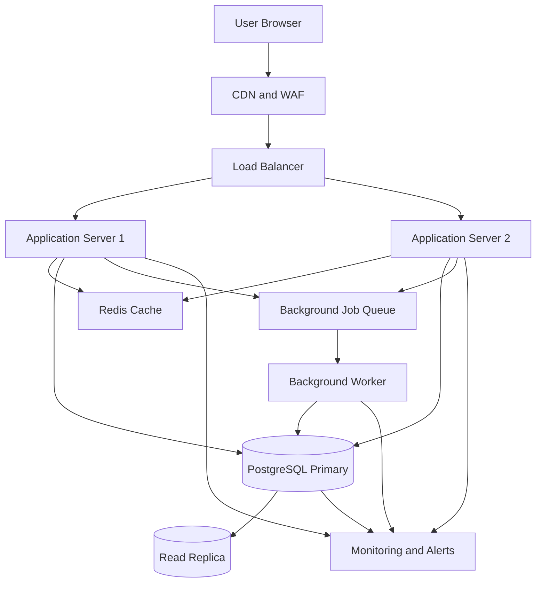

# QuickNotes System Architecture

## 1. Overview

QuickNotes is a web-based application for creating, viewing, updating, searching, and deleting personal notes.

The current assignment implements a small frontend demo using JSONPlaceholder. This document proposes a production architecture for a larger QuickNotes service.

## 2. Functional Requirements

1. Users can create an account and sign in.
2. Users can create, view, update, and delete their own notes.
3. Users can search and organize notes using tags.
4. Users can only access notes they are authorized to view.
5. The system validates note input and returns useful error messages.
6. The system supports pagination for large note collections.

## 3. Non-Functional Requirements

- Availability: target 99.9% monthly uptime.
- Performance: target a typical API read latency below 300 ms under normal load.
- Security: use HTTPS, authentication, authorization, input validation, and secure password hashing.
- Scalability: support adding application instances as demand grows.
- Reliability: use backups, monitoring, and recovery procedures.
- Maintainability: separate the frontend, API logic, and data storage.
- Data integrity: use transactions and database constraints where appropriate.

These are proposed design targets, not measured results.

## 4. Capacity Estimates

The following figures are illustrative assumptions for planning, not actual usage statistics.

| Metric | Assumption |
|---|---:|
| Registered users | 1,000,000 |
| Daily active users | 100,000 |
| API requests per active user per day | 40 |
| Reads | 80% of API requests |
| Writes | 20% of API requests |
| Average stored note content | 2 KB |
| Average notes created per active user per day | 2 |

### Daily API requests

100,000 active users × 40 requests per day:

```text
4,000,000 API requests per day
```

### Average requests per second

```text
4,000,000 / 86,400 = approximately 46.3 requests/second
```

### Average reads and writes per second

At an 80% read and 20% write split:

```text
Reads: 46.3 × 0.80 = approximately 37 reads/second
Writes: 46.3 × 0.20 = approximately 9 writes/second
```

### Peak traffic

If peak traffic is five times the daily average:

```text
Peak API traffic: approximately 232 requests/second
Peak reads: approximately 185 reads/second
Peak writes: approximately 46 writes/second
```

Real systems have uneven traffic, so load testing should validate these estimates.

### Annual note storage

If 100,000 active users create two notes each day:

```text
100,000 × 2 = 200,000 new notes/day

200,000 × 365 = 73,000,000 new notes/year

73,000,000 × 2 KB = approximately 146 GB/year
```

This estimates raw note content only. It excludes database indexes, row overhead, backups, replicas, attachments, and historical versions.

## 5. Proposed Architecture Diagram



## 6. Component Responsibilities

### Browser and frontend

- Displays the note form and note list.
- Performs basic input validation.
- Calls API endpoints using HTTPS.
- Shows loading, success, and error states.

### CDN and Web Application Firewall

- Delivers static assets from nearby locations.
- Helps protect against common web attacks and unwanted traffic.
- Can cache public static resources such as CSS and JavaScript.

Private note responses should not be cached publicly.

### Load balancer

- Distributes requests among healthy application instances.
- Performs health checks.
- Allows application servers to scale horizontally.

### Application servers

- Authenticate users and authorize note access.
- Validate incoming requests.
- Apply business rules.
- Read and write notes in the database.
- Return consistent HTTP responses.

### Redis cache

- Caches frequently accessed data where beneficial.
- Uses expiration times and invalidation when notes change.
- Reduces repeated database reads.

The database remains the source of truth. Cache failures must not cause data loss.

### PostgreSQL primary and read replica

- The primary handles writes and authoritative updates.
- A replica can serve eligible read queries.
- Replication may be delayed, so recently updated notes may need to be read from the primary when read-after-write consistency is required.

### Background queue and worker

- Handles non-urgent work such as notifications, exports, and cleanup.
- Keeps slow tasks out of the main API request path.
- Uses retries, monitoring, and idempotent job processing.

### Monitoring

- Tracks request latency, error rates, CPU, memory, database load, queue depth, and cache hit rates.
- Sends alerts when thresholds are exceeded.

## 7. GET Notes Request Flow

1. The browser sends a `GET /v1/notes` request.
2. The CDN/WAF handles applicable edge protections and forwards the API request.
3. The load balancer routes the request to a healthy application server.
4. The server authenticates the user and checks authorization.
5. The server checks Redis for an eligible cached result.
6. If the cache misses, the server queries PostgreSQL or an appropriate read replica.
7. The server returns the notes as JSON.
8. An eligible result may be cached with a suitable expiration policy.
9. The frontend renders the notes and updates the status message.

## 8. POST Note Request Flow

1. The browser sends a `POST /v1/notes` request with a JSON title and body.
2. The load balancer forwards the request to an application server.
3. The server authenticates the user and validates the request.
4. The server inserts the note into PostgreSQL using a parameterized query.
5. The database returns the new note ID and timestamps.
6. The application invalidates or updates any affected cached note lists.
7. The server returns `201 Created` with the new note.
8. The frontend displays the new note and a success message.

The production API must commit the database write before reporting success.

## 9. Failure Handling and Reliability

- If an application server fails, the load balancer removes it from service.
- If Redis is unavailable, the application can fall back to PostgreSQL with suitable load protection.
- If the database is unavailable, writes should fail clearly rather than report false success.
- Use automated database backups and test restoration regularly.
- Use database replication and a documented failover process.
- Retry transient failures carefully, especially for writes.
- Use request IDs and structured logs to help investigate incidents.
- Add rate limits to reduce abuse and protect the service during traffic spikes.

A single primary database can remain a failure point. Replication, tested failover, backups, and monitoring reduce risk but do not eliminate it.

## 10. Architecture Trade-Offs

| Decision | Advantage | Trade-off |
|---|---|---|
| PostgreSQL | Transactions, relations, constraints | Requires database operations and tuning |
| Redis caching | Faster repeated reads | Invalidation and stale-data risks |
| Load balancing | Better availability and scaling | More infrastructure to manage |
| Read replicas | More read capacity | Replication lag and added cost |
| Background queue | Keeps slow jobs off API requests | Retries and eventual completion add complexity |
| CDN | Efficient static asset delivery | Does not replace database or API scaling |
| Modular application | Easier initial deployment and debugging | Large deployments may eventually need service separation |

## 11. Security Considerations

- Enforce HTTPS.
- Store password hashes using a modern password-hashing algorithm.
- Keep secrets outside source code.
- Validate and constrain input on the server.
- Use parameterized SQL queries.
- Check note ownership on every protected operation.
- Apply request rate limits.
- Restrict database network access.
- Keep dependencies updated.
- Avoid logging passwords, access tokens, or private note content unnecessarily.

## 12. Implementation Roadmap

1. Build the frontend and demonstrate GET, POST, and DELETE using JSONPlaceholder.
2. Implement a real backend API and PostgreSQL schema.
3. Add authentication, ownership checks, and input validation.
4. Add automated tests, structured logging, and monitoring.
5. Introduce Redis caching only where measurements show a benefit.
6. Add replicas, background processing, and further scaling based on measured demand.

The architecture is a proposed production design. The current assignment is a frontend demonstration and does not implement the production infrastructure described here.
