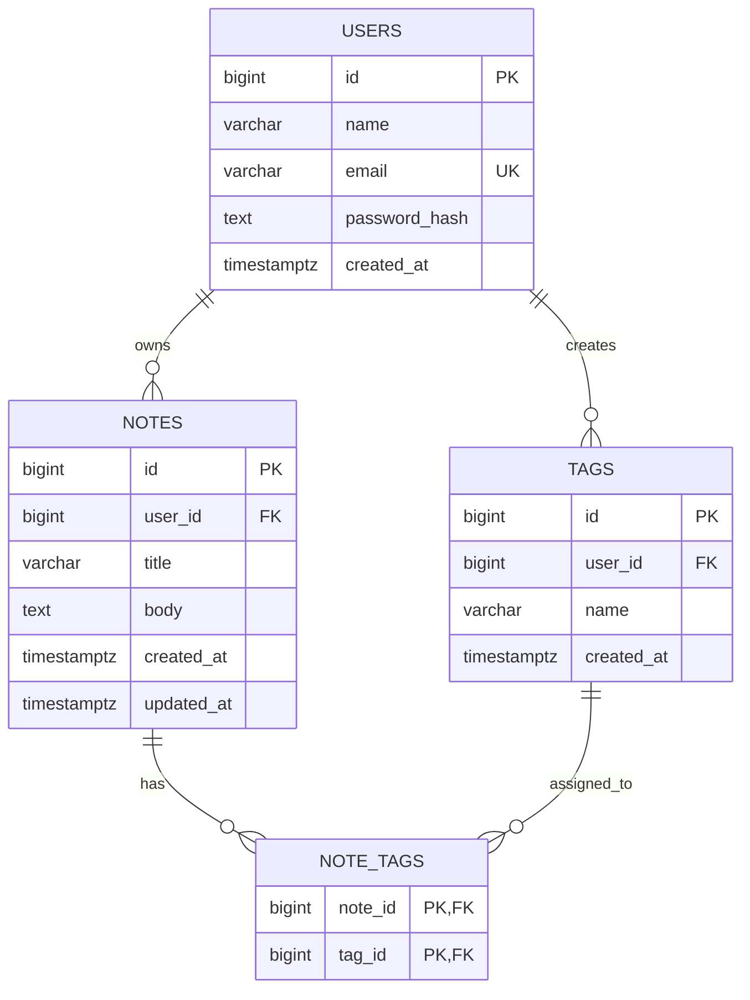

# QuickNotes Data Model

## 1. Overview

QuickNotes uses a relational database such as PostgreSQL to store users, notes, tags, and note-tag relationships.

The design uses primary keys to identify records and foreign keys to maintain referential integrity.

## 2. Database Tables

### Table 1: users

Stores registered user accounts.

| Column | Type | Constraints | Purpose |
|---|---|---|---|
| id | BIGINT | Primary key | Unique user ID |
| name | VARCHAR(100) | NOT NULL | User's name |
| email | VARCHAR(255) | UNIQUE, NOT NULL | Login email |
| password_hash | TEXT | NOT NULL | Secure password hash |
| created_at | TIMESTAMPTZ | NOT NULL | Registration time |

### Table 2: notes

Stores notes owned by users.

| Column | Type | Constraints | Purpose |
|---|---|---|---|
| id | BIGINT | Primary key | Unique note ID |
| user_id | BIGINT | Foreign key, NOT NULL | Note owner |
| title | VARCHAR(120) | NOT NULL | Note title |
| body | TEXT | NOT NULL | Note content |
| created_at | TIMESTAMPTZ | NOT NULL | Creation time |
| updated_at | TIMESTAMPTZ | NOT NULL | Last update time |

### Table 3: tags

Stores reusable labels for organizing notes.

| Column | Type | Constraints | Purpose |
|---|---|---|---|
| id | BIGINT | Primary key | Unique tag ID |
| user_id | BIGINT | Foreign key, NOT NULL | Tag owner |
| name | VARCHAR(50) | NOT NULL | Tag name |
| created_at | TIMESTAMPTZ | NOT NULL | Creation time |

A user cannot create two tags with the same name under the same account.

### Table 4: note_tags

Connects notes and tags through a many-to-many relationship.

| Column | Type | Constraints | Purpose |
|---|---|---|---|
| note_id | BIGINT | Foreign key, primary key | Related note |
| tag_id | BIGINT | Foreign key, primary key | Related tag |

The combination of `note_id` and `tag_id` is the composite primary key. It prevents attaching the same tag to the same note more than once.

## 3. Relationships

- One user can own many notes.
- One user can own many tags.
- One note can have many tags.
- One tag can belong to many notes through `note_tags`.

## 4. Entity Relationship Diagram



## 5. PostgreSQL Schema

```sql
CREATE TABLE users (
    id BIGINT GENERATED ALWAYS AS IDENTITY PRIMARY KEY,
    name VARCHAR(100) NOT NULL,
    email VARCHAR(255) NOT NULL UNIQUE,
    password_hash TEXT NOT NULL,
    created_at TIMESTAMPTZ NOT NULL DEFAULT NOW()
);

CREATE TABLE notes (
    id BIGINT GENERATED ALWAYS AS IDENTITY PRIMARY KEY,
    user_id BIGINT NOT NULL REFERENCES users(id) ON DELETE CASCADE,
    title VARCHAR(120) NOT NULL CHECK (LENGTH(TRIM(title)) > 0),
    body TEXT NOT NULL CHECK (LENGTH(TRIM(body)) > 0),
    created_at TIMESTAMPTZ NOT NULL DEFAULT NOW(),
    updated_at TIMESTAMPTZ NOT NULL DEFAULT NOW()
);

CREATE TABLE tags (
    id BIGINT GENERATED ALWAYS AS IDENTITY PRIMARY KEY,
    user_id BIGINT NOT NULL REFERENCES users(id) ON DELETE CASCADE,
    name VARCHAR(50) NOT NULL CHECK (LENGTH(TRIM(name)) > 0),
    created_at TIMESTAMPTZ NOT NULL DEFAULT NOW(),
    UNIQUE (user_id, name),
    UNIQUE (id, user_id)
);

CREATE TABLE note_tags (
    note_id BIGINT NOT NULL REFERENCES notes(id) ON DELETE CASCADE,
    tag_id BIGINT NOT NULL REFERENCES tags(id) ON DELETE CASCADE,
    PRIMARY KEY (note_id, tag_id)
);
```

## 6. Enforcing Tag Ownership

A user should not be able to attach another user's tag to their note. The following additional constraints enforce ownership at the database level.

```sql
ALTER TABLE notes
ADD CONSTRAINT notes_id_user_id_unique UNIQUE (id, user_id);

ALTER TABLE note_tags
ADD COLUMN user_id BIGINT NOT NULL;

ALTER TABLE note_tags
ADD CONSTRAINT note_tags_note_owner_fk
FOREIGN KEY (note_id, user_id)
REFERENCES notes(id, user_id)
ON DELETE CASCADE;

ALTER TABLE note_tags
ADD CONSTRAINT note_tags_tag_owner_fk
FOREIGN KEY (tag_id, user_id)
REFERENCES tags(id, user_id)
ON DELETE CASCADE;
```

For a fresh database, these constraints can instead be included directly in the original table definitions. If applying the statements to an existing populated database, migrate existing rows before making `user_id` non-null.

## 7. Example Queries

### Create a note

```sql
INSERT INTO notes (user_id, title, body)
VALUES (1, 'Study networking', 'Review VLANs and routing.')
RETURNING id, title, body, created_at;
```

### Retrieve a user's notes

```sql
SELECT id, title, body, created_at, updated_at
FROM notes
WHERE user_id = 1
ORDER BY updated_at DESC
LIMIT 20 OFFSET 0;
```

### Update a note

```sql
UPDATE notes
SET title = 'Study networking and security',
    updated_at = NOW()
WHERE id = 10
  AND user_id = 1
RETURNING id, title, body, updated_at;
```

The `user_id` condition ensures the query only updates a note belonging to that user.

### Delete a note

```sql
DELETE FROM notes
WHERE id = 10
  AND user_id = 1
RETURNING id;
```

### Retrieve notes with their tags

```sql
SELECT
    n.id,
    n.title,
    t.name AS tag_name
FROM notes AS n
LEFT JOIN note_tags AS nt ON nt.note_id = n.id
LEFT JOIN tags AS t ON t.id = nt.tag_id
WHERE n.user_id = 1
ORDER BY n.id;
```

### Count notes for each user

```sql
SELECT
    u.id,
    u.name,
    COUNT(n.id) AS total_notes
FROM users AS u
LEFT JOIN notes AS n ON n.user_id = u.id
GROUP BY u.id, u.name
ORDER BY total_notes DESC;
```

## 8. Indexes

```sql
CREATE INDEX idx_notes_user_updated
ON notes (user_id, updated_at DESC);

CREATE INDEX idx_tags_user
ON tags (user_id);

CREATE INDEX idx_note_tags_tag
ON note_tags (tag_id);
```

The primary keys and unique constraints already create indexes where required. The additional indexes support common note-list, tag-list, and reverse tag-lookup queries.

Indexes speed up reads but consume storage and add work to inserts, updates, and deletes. Measure real query performance before adding more.

## 9. Why PostgreSQL?

PostgreSQL is a good fit because QuickNotes has clear relationships, needs reliable transactions, and benefits from foreign-key constraints and structured queries.

A document database could work for some designs, but PostgreSQL provides a straightforward way to enforce ownership and maintain consistent relationships between users, notes, and tags.
